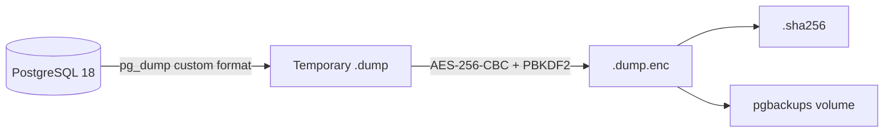

# ERP-GO Backup and Recovery Baseline

## Implemented capability

The repository implements an encrypted PostgreSQL logical backup in custom
`pg_dump` format. Each final `.dump.enc` artifact receives a SHA-256 manifest,
and CI recreates a dedicated database from the encrypted artifact and verifies
a marker row.



Encryption is mandatory by default. `scripts/backup.sh` exits unless
`BACKUP_ENCRYPTION_KEY` is present. `ALLOW_UNENCRYPTED_BACKUP=true` is reserved
for an explicitly approved non-production drill.

## Recovery objectives

The checked-in deployment does **not** configure continuous WAL archiving,
point-in-time recovery, immutable object storage, or cross-region replication.
Accordingly:

- A daily schedule has a worst-case logical-backup RPO of approximately 24
  hours, not five minutes.
- RTO is environment- and data-size-dependent and must be measured by a restore
  drill; the repository does not promise a fixed 30-minute RTO.
- PITR and off-site retention remain deployment architecture requirements. Do
  not claim them until the selected PostgreSQL platform is configured and a
  timed recovery exercise has passed.

For financial production use, the operator must add a Saudi-region backup
target (or another approved data-residency location), immutable retention,
separate credentials, alerting, and WAL-based PITR through the managed database
or a reviewed tool such as pgBackRest/WAL-G.

## Running the backup job

From the repository root, create
`deployments/compose/.env.production` from the root template and load actual
secrets from the deployment secret manager. Then run:

```bash
docker compose --env-file deployments/compose/.env.production \
  -f deployments/compose/docker-compose.prod.yml \
  --profile operations run --rm erp-backup
```

Schedule that exact one-shot command at 02:00 Asia/Riyadh using the host's
systemd timer, cron service, or the production orchestrator. Alert on any
non-zero exit and on backup age exceeding 26 hours.

The local retention default is 30 days (`BACKUP_RETENTION_DAYS`). This is an
operational cache, not a regulatory archive. Copy verified encrypted artifacts
and their `.sha256` files to the approved immutable off-site tier before local
pruning.

## Required verification

At least monthly, restore the newest encrypted artifact into an isolated
database, run migrations, verify application invariants, and record the actual
RPO/RTO. CI tests the mechanics on every change, but it does not substitute for
a production-volume disaster-recovery exercise.
