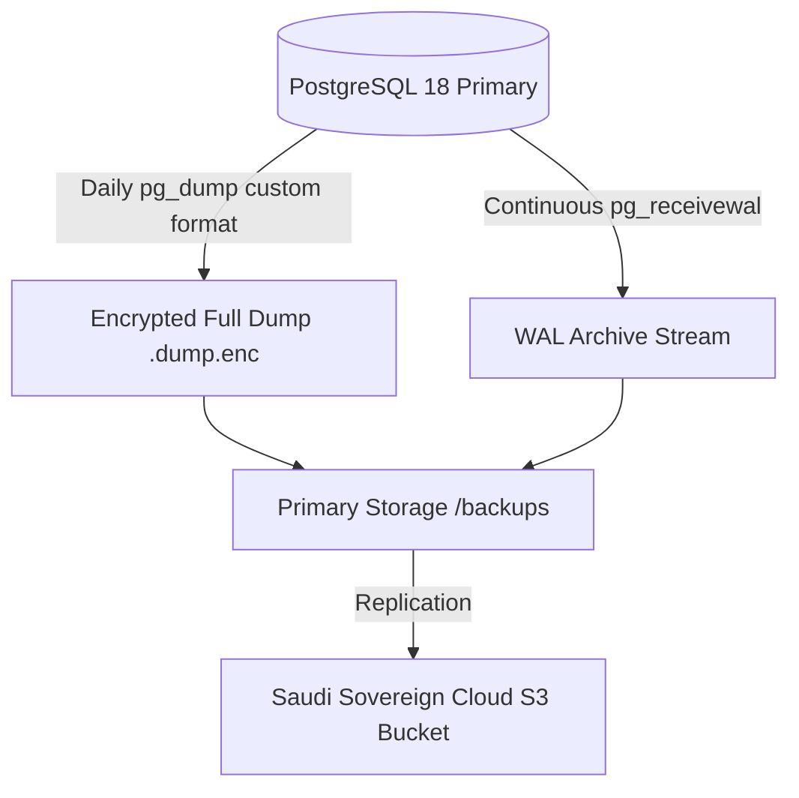

# Saudi Enterprise ERP - Backup & Archiving Strategy

## 1. Regulatory Compliance (Saudi ZATCA & Data Retention)
Under ZATCA (Zakat, Tax and Customs Authority) regulations and the Saudi Electronic Transactions Law:
- All accounting books, invoices, credit/debit notes, and audit logs must be securely retained for **minimum 6 to 10 years**.
- Data must reside within Kingdom of Saudi Arabia sovereign cloud boundaries or conform to the Saudi Personal Data Protection Law (PDPL).
- Immutable, tamper-evident backups must be taken continuously.

---

## 2. Backup Topology & Frequency



### Schedule & Granularity
1. **Continuous WAL Archiving**:
   - PostgreSQL WAL archiving allows **Point-In-Time Recovery (PITR)** down to the exact transaction before any incident or data corruption.
   - Target RPO (Recovery Point Objective): `< 5 minutes`.
2. **Daily Full Logical Backup**:
   - Automated `pg_dump` executed every midnight at **02:00 AST (Asia/Riyadh)**.
   - Target RTO (Recovery Time Objective): `< 30 minutes`.
3. **Weekly Storage Snapshot**:
   - Snapshot of persistent PostgreSQL and document-storage volumes.

---

## 3. Security, Encryption & Integrity
- **Compression**: PostgreSQL custom-format compression (`pg_dump --format=custom --compress=9`) keeps the archive compatible with `pg_restore` and supports selective/parallel restore.
- **Encryption**: AES-256 encryption via OpenSSL or GPG using dual-key split custody before writing to disk or cloud storage.
- **Integrity**: Every backup archive generates a companion `.sha256` checksum file to guarantee that archives have not suffered bitrot or tampering.

---

## 4. Retention Policy Matrix

| Tier | Frequency | Retention Duration | Target Storage |
| :--- | :--- | :--- | :--- |
| **Hot (Daily)** | Every 24 hours | 30 days | High-speed local SSD (`/backups`) |
| **Warm (Monthly)** | End-of-month snapshot | 12 months | Cloud S3 Standard (Riyadh region) |
| **Cold / Archive (Annual)** | End-of-fiscal-year | 10 years | S3 Glacier Flexible / Deep Archive (Saudi DC) |

---

## 5. Automated Backup Script Execution
Backups are orchestrated via `scripts/backup.sh` scheduled via cron or systemd timer:
```bash
# Example crontab entry for 02:00 AM Riyadh time
0 2 * * * /opt/erp/scripts/backup.sh >> /var/log/erp-backup.log 2>&1
```

The script creates `erp_<database>_<timestamp>.dump` (or `.dump.enc` when
`BACKUP_ENCRYPTION_KEY` is set) and a checksum named after the final artifact,
for example `erp_erp_db_20260918_020000.dump.enc.sha256`. A backup is not
considered valid until `sha256sum -c` succeeds and a restore drill has passed.
